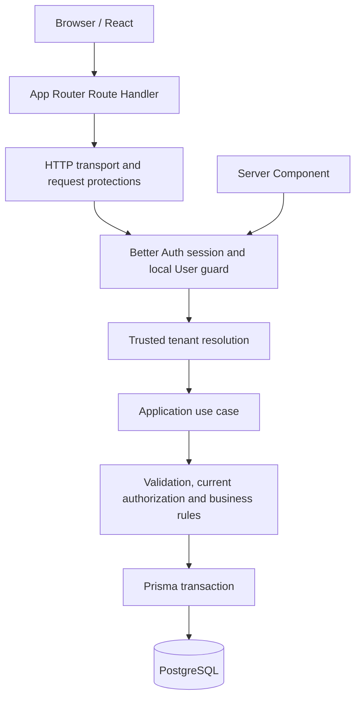

# Architecture

The backend is TypeScript in the same Next.js project as the interface. There is no separate Express, NestJS or FastAPI service. The layers keep browser concerns separate from database authority.

The diagram is the normal authenticated API path; POST header checks precede identity verification, while application input validation and authorization occur at their own boundaries. Invalid requests may stop earlier.

## Directory responsibilities

| Location | Responsibility |
|---|---|
| `src/app` | Server-rendered pages and thin HTTP route composition |
| `src/features/auth` | Small browser auth client and buttons |
| `src/features/workspaces` | Public workspace contract and server tenant access functions |
| `src/features/incidents` | Public DTOs, strict schemas, Client Component create form, server-only incident list, server incident and investigation use cases |
| `src/server/auth` | Server auth configuration, environment validation and identity guard |
| `src/server/application` | Transport-independent errors and trusted context contract |
| `src/server/http` | Request protections and safe HTTP error mapping |
| `src/server/db` | Server-only Prisma singleton |
| `prisma` | Schema and reviewed SQL migrations |
| `scripts` | Explicit local administrative bootstrap outside application runtime |
| `tests` | Unit and opt-in PostgreSQL integration tests |

A DTO (data transfer object) is an explicit public response, not a Prisma record. Factories accept dependencies for tests; production composition uses the existing singleton.

## Server versus client

Server Components verify identity/context and call use cases directly; they do not fetch their own API. The workspace page loads incidents and a separate current capability hint. Client form validation improves usability but supplies no authority. Browser mutations use the HTTP API, which independently rechecks access.

Auth, DB, tenant resolution and application modules use `server-only`. Client-safe contracts/schemas contain no credentials or database connection. Route handlers translate HTTP into use-case calls; use cases do not import Next.js response/redirect concepts.

Normal short transactions recheck current authorization and group writes, but do not serialize every concurrent revocation. Stronger ordering/retry infrastructure is deferred.
